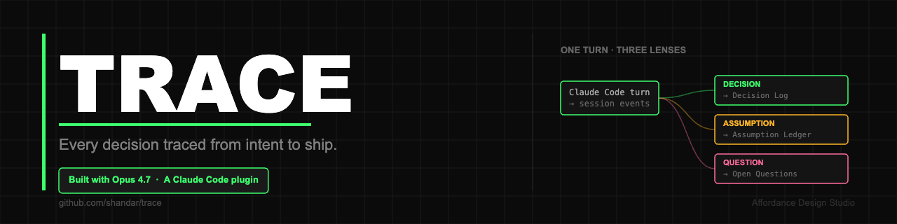

<p align="center">
  
</p>

# TRACE

**Every decision traced from intent to ship.**

TRACE is a Claude Code plugin that turns your PRD into a living document. You write the intent at the start of a project. Claude Code builds against it, and TRACE writes back: logging decisions, surfacing contradicted assumptions, and flagging new open questions as the build moves. At the end of the session, the document matches what shipped, not what you hoped.

---

## Install

In Claude Code:

```
/plugin install trace-prd --marketplace shandar/trace
```

Or add the marketplace first, then install:

```
/plugin marketplace add shandar/trace
/plugin install trace-prd@trace-marketplace
```

**Requirements:** Claude Code, and Node.js 18 or later on your `PATH` (the hooks are plain Node scripts with no dependencies and no build step).

---

## Quickstart

In any project where you want a living PRD:

```
/trace-prd:init
```

This creates `TRACE.md` with sections for Intent, Users, In scope, Out of scope, Open Questions, Decision Log and Assumption Ledger, and helps you write the Intent. Then build as usual. When you want the PRD to catch up:

```
/trace-prd:review
```

Claude reads what happened since the last review, proposes entries for the Decision Log, Assumption Ledger and Open Questions, and walks you through them one at a time: **accept**, **reword**, or **skip**. Accepted entries land in the right section of `TRACE.md`.

That is the whole loop.

---

## How it works

1. **PostToolUse hook** records each tool event (trimmed and redacted, see below) to `.trace/sessions/<session>.jsonl`. It only runs in projects that have a `TRACE.md`, so installing the plugin does nothing to your other repos.
2. **`/trace-prd:review`** reads the events since the last review through three lenses (decision, assumption, question), queues proposals in `.trace/pending.jsonl`, and lets you review them.
3. **Optional background mode.** If you add your own Anthropic API key in the plugin options, a **Stop hook** runs the three lenses in parallel after each turn that edited files, so proposals are already waiting when you run `/trace-prd:review`. Read-only turns are skipped, and each event is only ever sent once.

### Optional: background mode

Open `/plugin`, select **trace-prd**, and set:

| Option | What it does |
|---|---|
| `anthropic_api_key` | Your own key. Stored in your OS credential store (Keychain on macOS), never in a file. Leave empty to stay in in-session mode. |
| `model` | Model for background proposals. Default `claude-sonnet-5-5`. Three short calls per editing turn, billed to your key. |

TRACE never reads `ANTHROPIC_API_KEY` from your shell. Background mode only turns on when you set the option.

---

## Data and privacy

What TRACE stores, and where it goes:

| Data | Where | Leaves your machine? |
|---|---|---|
| Tool events (tool name, inputs, outputs) | `.trace/sessions/` in your project | **In-session mode:** no new destination; your Claude Code session reads them during `/trace-prd:review`. **Background mode:** sent to `api.anthropic.com` with your key, nowhere else. |
| Proposals | `.trace/pending.jsonl` | No |
| Accepted entries | `TRACE.md` | No |

Safeguards:

- **Redaction before anything is written.** API keys and tokens (Anthropic, OpenAI, GitHub, Slack, AWS, Google, JWTs), `Bearer` headers, private key blocks, and `NAME=value` pairs whose name looks like a credential (`*_KEY`, `*TOKEN`, `*SECRET`, `*PASSWORD`) become `[REDACTED]`.
- **Trimmed payloads.** Each string is capped at 2,000 characters; transcript paths, working directory and permission mode are not stored.
- **Raw logs stay out of git.** TRACE writes `.trace/.gitignore` containing `sessions/`. `TRACE.md` and the review queue are meant to travel with the repo.
- **Your key stays yours.** It is only sent as the `x-api-key` header to `api.anthropic.com`, and is never logged, printed, or written to disk.
- **No telemetry.** TRACE makes no other network calls.

---

## Project layout

```
trace/
├── .claude-plugin/
│   ├── plugin.json         Plugin manifest and options
│   └── marketplace.json    Lets /plugin marketplace add shandar/trace work
├── hooks/hooks.json        PostToolUse (logger) and Stop (background proposer)
├── commands/
│   ├── init.md             /trace-prd:init
│   └── review.md           /trace-prd:review
├── scripts/
│   ├── lib.mjs             Paths, redaction, queue, TRACE.md section writer
│   ├── event-logger.mjs    PostToolUse hook
│   ├── session-proposer.mjs  Stop hook (background mode only)
│   └── trace.mjs           Helper behind the slash commands; owns every file write
└── TRACE.md                This repo's own living PRD, written by TRACE
```

---

## The recursive proof

This repo's `TRACE.md` was written by TRACE itself.

Commit [`797daaf`](https://github.com/shandar/trace/commit/797daaf) is the first moment TRACE used TRACE to document itself: a Decision Log entry written by the hook, vetted through the review loop, committed to `main`. Every later entry in `## Decision Log`, `## Assumption Ledger` and `## Open Questions` followed the same path.

Read `TRACE.md` to see what a living PRD looks like in the wild.

---

## Known limitations

- Hooks need a local Node.js runtime, so TRACE is built for Claude Code. Claude apps and Cowork are not supported.
- Tested on macOS. Linux should work; Windows is untested.

---

## Origin

Started at the [Built with Opus 4.7 hackathon](https://cerebralvalley.ai/e/built-with-4-7-hackathon) as a terminal CLI, and rebuilt as a Claude Code plugin.

## Author

Shandar Junaid, UX designer turned AI product builder. [Affordance Design Studio](https://affordance.design)

Most of the code in this repo was written by Claude Code under direction. The product calls, the architecture decisions and the story are mine.

## License

MIT. See [LICENSE](./LICENSE).
